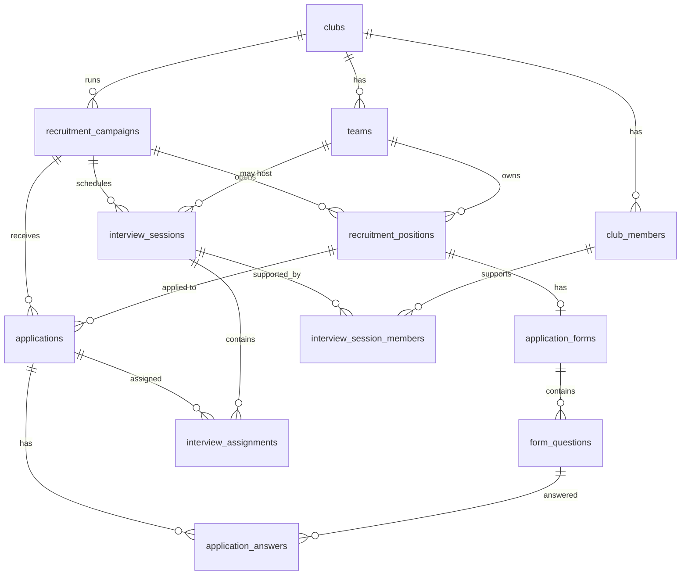

# Thiết kế cơ sở dữ liệu: Hệ thống quản lý tuyển và phỏng vấn CLB

Nền tảng: **Supabase (PostgreSQL)**

## 1. Nguyên tắc thiết kế

- **Ứng viên không cần tài khoản.** Thông tin cá nhân lưu thẳng trong `applications`.
- **Thành viên CLB (`club_members`) không nhất thiết có tài khoản.** Họ chỉ được gán vào ca phỏng vấn để hỗ trợ.
- **Chỉ ban quản trị mới đăng nhập.** Dùng `auth.users` của Supabase, bảng `profiles` để lưu thông tin thêm, cột `club_members.role` để phân quyền theo từng CLB.
- **Không dùng bộ 4 bảng RBAC** (`roles`, `permissions`, `role_permissions`, `user_roles`). Vai trò là enum, quyền được kiểm soát bằng **RLS policy**.
- **Đánh giá đơn giản:** điểm, nhận xét, kết quả nằm trực tiếp trong `interview_assignments`.
- **Hỗ trợ nhiều CLB** dùng chung hệ thống (hầu hết bảng truy ngược được về `club_id`).

## 2. Sơ đồ quan hệ (ERD)



## 3. Danh sách bảng

| Nhóm | Bảng | Mục đích |
|---|---|---|
| Tài khoản & quyền | `profiles` | Thông tin mở rộng của `auth.users` |
| CLB | `clubs` | Câu lạc bộ |
| | `teams` | Các ban trong CLB |
| | `club_members` | Danh sách thành viên (có thể không có tài khoản) |
| Tuyển dụng | `recruitment_campaigns` | Đợt tuyển |
| | `recruitment_positions` | Vị trí tuyển trong đợt |
| | `application_forms` | Form đăng ký riêng của từng ban tuyển |
| | `form_questions` | Câu hỏi trong form |
| | `applications` | Đơn ứng tuyển |
| | `application_answers` | Câu trả lời của ứng viên |
| Phỏng vấn | `interview_sessions` | Ca phỏng vấn |
| | `interview_assignments` | Xếp ứng viên vào ca, kèm kết quả |
| | `interview_session_members` | Thành viên hỗ trợ ca phỏng vấn |

## 4. Script SQL

### 4.1. Enum

```sql
create type club_role as enum ('owner', 'admin', 'organizer');

create type campaign_status as enum ('draft', 'open', 'closed', 'done');

create type question_type as enum (
  'text', 'long_text', 'single_choice', 'multi_choice', 'number', 'date', 'file'
);

create type application_status as enum (
  'submitted', 'screening', 'interview', 'passed', 'failed', 'withdrawn'
);

create type assignment_status as enum (
  'scheduled', 'attended', 'absent', 'rescheduled'
);

create type interview_result as enum ('pending', 'pass', 'fail', 'consider');
```

### 4.2. Tài khoản và phân quyền

```sql
-- Thông tin mở rộng của tài khoản đăng nhập (auth.users do Supabase quản lý)
create table profiles (
  id uuid primary key references auth.users(id) on delete cascade,
  full_name text,
  avatar_url text,
  created_at timestamptz not null default now()
);

create table clubs (
  id uuid primary key default gen_random_uuid(),
  name text not null,
  description text,
  created_at timestamptz not null default now()
);

```

### 4.3. CLB, ban, thành viên

```sql
create table teams (
  id uuid primary key default gen_random_uuid(),
  club_id uuid not null references clubs(id) on delete cascade,
  name text not null,
  description text,
  created_at timestamptz not null default now()
);

create table club_members (
  id uuid primary key default gen_random_uuid(),
  club_id uuid not null references clubs(id) on delete cascade,
  user_id uuid references auth.users(id) on delete set null, -- không bắt buộc
  role club_role not null default 'organizer',
  student_code text,
  full_name text not null,
  class_name text,
  is_active boolean not null default true,
  created_at timestamptz not null default now(),
  unique (club_id, student_code)
);
```

### 4.4. Tuyển dụng

```sql
create table recruitment_campaigns (
  id uuid primary key default gen_random_uuid(),
  club_id uuid not null references clubs(id) on delete cascade,
  name text not null,
  description text,
  start_date timestamptz,
  end_date timestamptz,
  status campaign_status not null default 'draft',
  created_at timestamptz not null default now(),
  updated_at timestamptz not null default now()
);

create table recruitment_positions (
  id uuid primary key default gen_random_uuid(),
  campaign_id uuid not null references recruitment_campaigns(id) on delete cascade,
  team_id uuid references teams(id) on delete set null,
  name text not null,
  description text,
  quantity int,                          -- chỉ tiêu tuyển
  created_at timestamptz not null default now()
);

-- Mỗi ban tuyển có tối đa một form riêng.
create table application_forms (
  id uuid primary key default gen_random_uuid(),
  position_id uuid not null unique references recruitment_positions(id) on delete cascade,
  name text not null,
  description text,
  created_at timestamptz not null default now()
);

create table form_questions (
  id uuid primary key default gen_random_uuid(),
  form_id uuid not null references application_forms(id) on delete cascade,
  question_text text not null,
  question_type question_type not null default 'text',
  options jsonb,                         -- danh sách lựa chọn cho single/multi_choice
  is_required boolean not null default false,
  order_index int not null default 0,
  created_at timestamptz not null default now()
);

create table applications (
  id uuid primary key default gen_random_uuid(),
  campaign_id uuid not null references recruitment_campaigns(id) on delete cascade,
  position_id uuid not null references recruitment_positions(id) on delete cascade,

  -- Thông tin ứng viên (không cần tài khoản)
  full_name text not null,
  email text not null,
  phone text,
  student_code text,
  class_name text,

  status application_status not null default 'submitted',
  tracking_token text not null unique default encode(gen_random_bytes(16), 'hex'),
  submitted_at timestamptz not null default now(),
  created_at timestamptz not null default now(),
  updated_at timestamptz not null default now(),

  unique (position_id, email)            -- chống nộp trùng cùng một vị trí
);

create table application_answers (
  id uuid primary key default gen_random_uuid(),
  application_id uuid not null references applications(id) on delete cascade,
  question_id uuid not null references form_questions(id) on delete cascade,
  answer_text text,                      -- dùng cho text, long_text, number, date
  answer_json jsonb,                     -- dùng cho multi_choice, file
  unique (application_id, question_id)
);
```

### 4.5. Phỏng vấn

```sql
create table interview_sessions (
  id uuid primary key default gen_random_uuid(),
  campaign_id uuid not null references recruitment_campaigns(id) on delete cascade,
  team_id uuid references teams(id) on delete set null,  -- null nếu là ca chung
  round int not null default 1,
  start_time timestamptz not null,
  end_time timestamptz not null,
  location text,
  meeting_link text,
  capacity int,
  note text,
  created_at timestamptz not null default now(),
  check (end_time > start_time)
);

-- Xếp ứng viên vào ca, đồng thời lưu kết quả đánh giá
create table interview_assignments (
  id uuid primary key default gen_random_uuid(),
  application_id uuid not null references applications(id) on delete cascade,
  session_id uuid not null references interview_sessions(id) on delete cascade,
  status assignment_status not null default 'scheduled',
  score numeric(4,2),
  comment text,
  result interview_result not null default 'pending',
  created_at timestamptz not null default now(),
  updated_at timestamptz not null default now(),
  unique (application_id, session_id)
);

-- Thành viên CLB hỗ trợ ca phỏng vấn (không chấm điểm)
create table interview_session_members (
  session_id uuid not null references interview_sessions(id) on delete cascade,
  member_id uuid not null references club_members(id) on delete cascade,
  duty text,                             -- ví dụ: đón ứng viên, ghi chép, kỹ thuật
  primary key (session_id, member_id)
);
```

### 4.6. Index gợi ý

```sql
create index on teams (club_id);
create index on club_members (club_id);
create index on recruitment_campaigns (club_id);
create index on recruitment_positions (campaign_id);
create index on form_questions (form_id, order_index);
create index on applications (campaign_id, status);
create index on applications (position_id);
create index on application_answers (application_id);
create index on interview_sessions (campaign_id, start_time);
create index on interview_assignments (session_id);
```

## 5. Bảo mật với Supabase (RLS)

Bật RLS cho tất cả bảng:

```sql
alter table clubs enable row level security;
alter table club_members enable row level security;
alter table teams enable row level security;
alter table recruitment_campaigns enable row level security;
alter table recruitment_positions enable row level security;
alter table application_forms enable row level security;
alter table form_questions enable row level security;
alter table applications enable row level security;
alter table application_answers enable row level security;
alter table interview_sessions enable row level security;
alter table interview_assignments enable row level security;
alter table interview_session_members enable row level security;
```

### 5.1. Hàm kiểm tra quyền

```sql
-- Người dùng hiện tại có thuộc ban quản trị của CLB này không?
create or replace function is_club_member(p_club_id uuid)
returns boolean
language sql
security definer
stable
set search_path = public
as $$
  select exists (
    select 1 from club_members
    where user_id = auth.uid() and club_id = p_club_id and is_active
  );
$$;

-- Có phải admin/owner của CLB không?
create or replace function is_club_admin(p_club_id uuid)
returns boolean
language sql
security definer
stable
set search_path = public
as $$
  select exists (
    select 1 from club_members
    where user_id = auth.uid()
      and club_id = p_club_id
      and is_active
      and role in ('owner', 'admin')
  );
$$;
```

### 5.2. Policy mẫu

```sql
-- Ban quản trị đọc/sửa campaign của CLB mình
create policy "staff read campaigns" on recruitment_campaigns
  for select using (is_club_member(club_id));

create policy "admin write campaigns" on recruitment_campaigns
  for all using (is_club_admin(club_id)) with check (is_club_admin(club_id));

-- Người chưa đăng nhập (anon) chỉ đọc campaign đang mở
create policy "public read open campaigns" on recruitment_campaigns
  for select to anon using (status = 'open');

-- Ban quản trị xem đơn ứng tuyển của CLB mình
create policy "staff read applications" on applications
  for select using (
    exists (
      select 1 from recruitment_campaigns c
      where c.id = applications.campaign_id and is_club_member(c.club_id)
    )
  );
```

Các policy đọc form/câu hỏi công khai cần nối theo `application_forms.position_id -> recruitment_positions.campaign_id -> recruitment_campaigns.club_id` và chỉ cho đọc khi campaign đang mở, trong ngày tuyển. Ví dụ:

```sql
create policy "staff read application forms" on application_forms
  for select to authenticated using (
    exists (
      select 1 from recruitment_positions p
      join recruitment_campaigns c on c.id = p.campaign_id
      where p.id = application_forms.position_id and is_club_member(c.club_id)
    )
  );

create policy "admin write application forms" on application_forms
  for all to authenticated using (
    exists (
      select 1 from recruitment_positions p
      join recruitment_campaigns c on c.id = p.campaign_id
      where p.id = application_forms.position_id and is_club_admin(c.club_id)
    )
  ) with check (
    exists (
      select 1 from recruitment_positions p
      join recruitment_campaigns c on c.id = p.campaign_id
      where p.id = application_forms.position_id and is_club_admin(c.club_id)
    )
  );

create policy "public read open application forms" on application_forms
  for select to anon, authenticated using (
    exists (
      select 1 from recruitment_positions p
      join recruitment_campaigns c on c.id = p.campaign_id
      where p.id = application_forms.position_id
        and c.status = 'open'
        and (c.start_date is null or c.start_date <= now())
        and (c.end_date is null or c.end_date >= now())
    )
  );

create policy "public read open form questions" on form_questions
  for select to anon, authenticated using (
    exists (
      select 1 from application_forms f
      join recruitment_positions p on p.id = f.position_id
      join recruitment_campaigns c on c.id = p.campaign_id
      where f.id = form_questions.form_id
        and c.status = 'open'
        and (c.start_date is null or c.start_date <= now())
        and (c.end_date is null or c.end_date >= now())
    )
  );
```

Làm tương tự policy staff/admin cho `form_questions`, `teams`, `recruitment_positions`, `interview_sessions`, `interview_assignments`, `interview_session_members`.

### 5.3. Luồng của ứng viên (anon)

**Không cho `anon` `INSERT` hoặc `SELECT` trực tiếp trên `applications`.** Thay vào đó dùng RPC chạy `security definer`:

```sql
-- Nộp đơn: kiểm tra campaign đang mở, chặn trùng, ghi cả đơn và câu trả lời
create or replace function submit_application(
  p_position_id uuid,
  p_full_name text,
  p_email text,
  p_phone text,
  p_student_code text,
  p_class_name text,
  p_answers jsonb   -- [{ "question_id": "...", "text": "...", "json": {...} }]
)
returns text         -- trả về tracking_token
language plpgsql
security definer
set search_path = public
as $$
declare
  v_campaign_id uuid;
  v_app_id uuid;
  v_token text;
begin
  select p.campaign_id into v_campaign_id
  from recruitment_positions p
  join recruitment_campaigns c on c.id = p.campaign_id
  where p.id = p_position_id
    and c.status = 'open'
    and (c.start_date is null or c.start_date <= now())
    and (c.end_date is null or c.end_date >= now());

  if v_campaign_id is null then
    raise exception 'Đợt tuyển không mở hoặc vị trí không tồn tại';
  end if;

  if exists (
    select 1
    from jsonb_array_elements(p_answers) a
    where not exists (
      select 1
      from application_forms f
      join form_questions q on q.form_id = f.id
      where f.position_id = p_position_id
        and q.id = (a->>'question_id')::uuid
    )
  ) then
    raise exception 'Câu trả lời không thuộc biểu mẫu của ban tuyển';
  end if;

  insert into applications (
    campaign_id, position_id, full_name, email, phone, student_code, class_name
  )
  values (
    v_campaign_id, p_position_id, p_full_name, lower(p_email), p_phone,
    p_student_code, p_class_name
  )
  returning id, tracking_token into v_app_id, v_token;

  insert into application_answers (application_id, question_id, answer_text, answer_json)
  select v_app_id,
         (a->>'question_id')::uuid,
         a->>'text',
         a->'json'
  from jsonb_array_elements(p_answers) a;

  return v_token;
end;
$$;

grant execute on function submit_application to anon;
```

```sql
-- Xem lại trạng thái đơn bằng token (chỉ trả về thông tin cần thiết)
create or replace function get_application_by_token(p_token text)
returns table (
  full_name text,
  position_name text,
  status application_status,
  submitted_at timestamptz,
  interview_start timestamptz,
  interview_location text,
  interview_link text
)
language sql
security definer
stable
set search_path = public
as $$
  select a.full_name,
         p.name,
         a.status,
         a.submitted_at,
         s.start_time,
         s.location,
         s.meeting_link
  from applications a
  join recruitment_positions p on p.id = a.position_id
  left join interview_assignments ia on ia.application_id = a.id
  left join interview_sessions s on s.id = ia.session_id
  where a.tracking_token = p_token;
$$;

grant execute on function get_application_by_token to anon;
```

## 6. Luồng nghiệp vụ

1. **Quản trị** tạo `recruitment_campaigns`, `recruitment_positions`, form riêng trong `application_forms` cho từng ban, rồi tạo `form_questions`.
2. Chuyển campaign sang `open`. Ứng viên truy cập trang đăng ký (không cần đăng nhập).
3. Ứng viên gọi `submit_application` và nhận `tracking_token`.
4. **Quản trị** lọc đơn, đổi `applications.status` sang `screening` hoặc `interview`.
5. **Quản trị** tạo `interview_sessions`, gán thành viên hỗ trợ qua `interview_session_members`.
6. **Quản trị** xếp ứng viên vào ca qua `interview_assignments`.
7. Sau phỏng vấn, cập nhật `status`, `score`, `comment`, `result` trong `interview_assignments`.
8. Chốt kết quả: cập nhật `applications.status` thành `passed` hoặc `failed`.
9. Ứng viên xem kết quả qua `get_application_by_token`.

## Phụ lục: policy đọc CLB cho quản trị

Đăng nhập cần đọc membership của chính tài khoản. Áp dụng các policy dưới đây sau khi bật RLS (không thay đổi schema):

```sql
create policy "users read own club memberships" on club_members
  for select to authenticated using (user_id = auth.uid());

create policy "members read their clubs" on clubs
  for select to authenticated using (
    exists (
      select 1 from club_members m
      where m.club_id = clubs.id and m.user_id = auth.uid() and m.is_active
    )
  );
```

Tài khoản quản trị cần có một dòng `club_members` với `user_id` trỏ tới `auth.users.id` và `is_active = true`. Vai trò theo từng CLB được lưu trực tiếp trong `club_members.role`; role `organizer` chỉ có quyền đọc.
