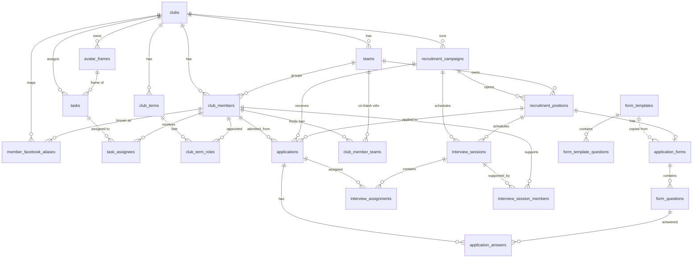

# Thiết kế cơ sở dữ liệu: Hệ thống quản lý tuyển và phỏng vấn CLB

Nền tảng: **Supabase (PostgreSQL)**

## 1. Nguyên tắc thiết kế

- **Ứng viên không cần tài khoản.** Thông tin cá nhân lưu thẳng trong `applications`.
- **Thành viên CLB (`club_members`) không nhất thiết có tài khoản.** Thành viên có tài khoản (`user_id`) đăng nhập được; vai trò `member` chỉ vào trang cá nhân `/me`.
- **Vai trò theo từng CLB** nằm ở `club_members.role`: `owner` (Ban chủ nhiệm), `admin` (Ban chủ chốt), `member` (Thành viên). Một người trong Ban chủ nhiệm là **Chủ nhiệm** (`club_members.is_head`). Ban chủ chốt chỉ có các **quyền chức năng** (`club_members.permissions`, xem mục 5.2.1). `club_members.title` là chức danh hiển thị, không ảnh hưởng quyền.
- **Ứng viên không phải vai trò.** Đơn `passed` được Ban chủ chốt "kết nạp" thành dòng `club_members` vai trò `member` (hàm `admit_applications`).
- **Nhiệm kỳ** (`club_terms`, `club_term_roles`): Chủ nhiệm soạn danh sách Ban chủ nhiệm/Ban chủ chốt cho nhiệm kỳ mới ở trạng thái nháp, rồi kích hoạt (`activate_term`) để đổi vai trò hàng loạt.
- Dùng `auth.users` của Supabase, bảng `profiles` để lưu thông tin thêm.
- **Không dùng bộ 4 bảng RBAC** (`roles`, `permissions`, `role_permissions`, `user_roles`). Vai trò là enum, quyền chức năng là mảng `text[]` trên `club_members`, và mọi thứ được kiểm soát bằng **RLS policy** (mục 5.2.1).
- **Đánh giá đơn giản:** điểm, nhận xét, kết quả nằm trực tiếp trong `interview_assignments`.
- **Hỗ trợ nhiều CLB** dùng chung hệ thống (hầu hết bảng truy ngược được về `club_id`).

## 2. Sơ đồ quan hệ (ERD)



## 3. Danh sách bảng

| Nhóm | Bảng | Mục đích |
|---|---|---|
| Tài khoản & quyền | `profiles` | Thông tin mở rộng của `auth.users` |
| CLB | `clubs` | Câu lạc bộ |
| | `teams` | Các ban trong CLB |
| | `club_members` | Danh sách thành viên (có thể không có tài khoản), kèm vai trò |
| | `club_member_teams` | Tập ban của một thành viên (một người thuộc nhiều ban; `club_members.team_id` = ban chính) |
| | `club_terms` | Nhiệm kỳ của CLB (`draft`, `active`, `ended`) |
| | `club_term_roles` | Danh sách Ban chủ nhiệm/Ban chủ chốt của một nhiệm kỳ |
| Giao việc | `tasks` | Việc Ban chủ chốt giao (tiêu đề, hạn, `open`/`closed`) |
| | `task_assignees` | Người nhận việc, trạng thái, ghi chú, mốc nhắc |
| Tương tác Facebook | `avatar_frames` | Khung avatar PNG của CLB (file nằm trong bucket `avatar-frames`) |
| | `member_facebook_aliases` | Gắn khóa hồ sơ Facebook (`id:...`/`u:...`) với thành viên khi link trong hồ sơ không khớp |
| tuyển gen | `recruitment_campaigns` | Đợt tuyển |
| | `recruitment_positions` | Vị trí tuyển trong đợt |
| | `form_templates` | Mẫu biểu mẫu có thể tái sử dụng |
| | `form_template_questions` | Câu hỏi gốc thuộc mẫu |
| | `application_forms` | Form đăng ký riêng của từng ban tuyển |
| | `form_questions` | Câu hỏi trong form |
| | `applications` | Đơn ứng tuyển |
| | `application_answers` | Câu trả lời của ứng viên |
| Phỏng vấn | `interview_sessions` | Ca phỏng vấn |
| | `interview_assignments` | Xếp ứng viên vào ca, kèm kết quả |
| | `interview_session_members` | Thành viên hỗ trợ ca phỏng vấn |

## 4. Script SQL

Phân quyền theo chức năng và Chủ nhiệm được thêm bởi `supabase/migrations/20261115000000_permissions.sql` (xem mục 5.2.1; các mục cũ bên dưới mô tả quyền theo `is_club_admin` chỉ còn đúng cho phần đọc chung).

Schema gốc, RLS, function và seed tối thiểu nằm trong migration baseline `supabase/migrations/20261023000000_init.sql`. Vai trò thành viên, nhiệm kỳ và kết nạp được thêm bởi `supabase/migrations/20261110000000_member_roles_terms.sql` (các khối SQL bên dưới đã phản ánh trạng thái sau migration này). Giao việc, nhắc hạn và đóng góp được thêm bởi `supabase/migrations/20261111000000_tasks.sql` (xem mục 6.4). Đối chiếu tương tác Facebook và avatar khung được thêm bởi `supabase/migrations/20261112000000_engagement_frames.sql` (xem mục 6.5). Các script tăng dần trước đây chỉ còn giá trị tham khảo trong `supabase/migration/legacy/` và không cần chạy trên database mới. Hướng dẫn bootstrap owner đầu tiên nằm trong `README.md`.

### 4.1. Enum

```sql
-- 'member' đổi tên từ 'organizer' ở migration 20261110000000
create type club_role as enum ('owner', 'admin', 'member');

create type campaign_status as enum ('draft', 'open', 'closed', 'done');

create type question_type as enum (
  'text', 'long_text', 'single_choice', 'multi_choice', 'number', 'date', 'file'
);

create type application_status as enum (
  'submitted', 'screening', 'interview', 'passed', 'failed', 'withdrawn'
);

create type assignment_status as enum (
  'scheduled', 'attended', 'absent', 'rescheduled'
);

create type interview_result as enum ('pending', 'pass', 'fail', 'consider');
```

### 4.2. Tài khoản và phân quyền

```sql
-- Thông tin mở rộng của tài khoản đăng nhập (auth.users do Supabase quản lý)
create table profiles (
  id uuid primary key references auth.users(id) on delete cascade,
  full_name text,
  avatar_url text,
  created_at timestamptz not null default now()
);

create table clubs (
  id uuid primary key default gen_random_uuid(),
  name text not null,
  description text,
  created_at timestamptz not null default now()
  -- + mail_sender_user_id uuid (migration 20261111000000, xem mục 6.4)
);

```

### 4.3. CLB, ban, thành viên

```sql
create table teams (
  id uuid primary key default gen_random_uuid(),
  club_id uuid not null references clubs(id) on delete cascade,
  name text not null,
  description text,
  image_url text,
  duties text[] not null default '{}', -- việc chính, tối đa 6 (trang Giới thiệu)
  fit_for text,                        -- "Hợp với bạn nếu…", tối đa 300 ký tự
  created_at timestamptz not null default now()
);

create table club_members (
  id uuid primary key default gen_random_uuid(),
  club_id uuid not null references clubs(id) on delete cascade,
  team_id uuid references teams(id) on delete set null,
  user_id uuid references auth.users(id) on delete set null, -- không bắt buộc
  role club_role not null default 'member',
  student_code text,
  full_name text not null,
  class_name text,
  email text,
  phone text,
  facebook_url text check (facebook_url is null or facebook_url ~ '^https://(www\.|m\.|web\.)?(facebook|fb)\.com/.+'),
  title text,                                  -- chức danh hiển thị (vd. "Phó chủ nhiệm"), không ảnh hưởng quyền
  -- + permissions text[] not null default '{}'  (migration 20261115000000, mục 5.2.1)
  -- + is_head boolean not null default false     (Chủ nhiệm; unique một phần theo club_id)
  is_active boolean not null default true,
  created_at timestamptz not null default now(),
  unique (club_id, student_code),
  unique (club_id, user_id)
);

-- Một email chỉ thuộc một thành viên trong CLB
create unique index club_members_club_email_unique
  on club_members (club_id, lower(email)) where email is not null;

-- Nhiệm kỳ: tối đa một nhiệm kỳ 'active' mỗi CLB
create table club_terms (
  id uuid primary key default gen_random_uuid(),
  club_id uuid not null references clubs(id) on delete cascade,
  name text not null,
  start_date date,
  end_date date,
  status text not null default 'draft' check (status in ('draft', 'active', 'ended')),
  activated_at timestamptz,
  activated_by uuid references auth.users(id) on delete set null,
  created_at timestamptz not null default now(),
  check (start_date is null or end_date is null or end_date >= start_date)
);
create unique index club_terms_one_active_idx on club_terms (club_id) where status = 'active';

-- Danh sách Ban chủ nhiệm/Ban chủ chốt của nhiệm kỳ (trigger: member và team cùng CLB với term)
create table club_term_roles (
  term_id uuid not null references club_terms(id) on delete cascade,
  member_id uuid not null references club_members(id) on delete cascade,
  role club_role not null check (role in ('owner', 'admin')),
  title text,
  team_id uuid references teams(id) on delete set null,
  -- + permissions text[] not null default '{}', is_head boolean not null default false (mục 5.2.1)
  primary key (term_id, member_id)
);
```

### 4.4. tuyển gen

```sql
create table recruitment_campaigns (
  id uuid primary key default gen_random_uuid(),
  club_id uuid not null references clubs(id) on delete cascade,
  name text not null,
  description text,
  start_date timestamptz,
  end_date timestamptz,
  status campaign_status not null default 'draft',
  created_at timestamptz not null default now(),
  updated_at timestamptz not null default now()
);

create table recruitment_positions (
  id uuid primary key default gen_random_uuid(),
  campaign_id uuid not null references recruitment_campaigns(id) on delete cascade,
  team_id uuid references teams(id) on delete set null,
  name text not null,
  description text,
  created_at timestamptz not null default now()
);

-- Mẫu dùng để khởi tạo biểu mẫu. Câu hỏi được sao chép vào form_questions,
-- vì vậy thay đổi mẫu sau này không làm thay đổi các form đã tạo.
create table form_templates (
  id uuid primary key default gen_random_uuid(),
  name text not null,
  description text,
  is_default boolean not null default false,
  created_at timestamptz not null default now(),
  updated_at timestamptz not null default now()
);

create table form_template_questions (
  id uuid primary key default gen_random_uuid(),
  template_id uuid not null references form_templates(id) on delete cascade,
  question_text text not null,
  question_type question_type not null default 'text',
  field_key text check (field_key is null or field_key in ('full_name', 'email', 'phone', 'student_code', 'class_name', 'facebook_url')),
  options jsonb,
  is_required boolean not null default false,
  order_index int not null default 0,
  created_at timestamptz not null default now()
);

-- Mỗi vị trí tuyển có tối đa một form riêng.
create table application_forms (
  id uuid primary key default gen_random_uuid(),
  position_id uuid not null unique references recruitment_positions(id) on delete cascade,
  source_template_id uuid references form_templates(id) on delete set null,
  name text not null,
  description text,
  created_at timestamptz not null default now()
);

create table form_questions (
  id uuid primary key default gen_random_uuid(),
  form_id uuid not null references application_forms(id) on delete cascade,
  question_text text not null,
  question_type question_type not null default 'text',
  field_key text check (field_key is null or field_key in ('full_name', 'email', 'phone', 'student_code', 'class_name', 'facebook_url')),
  options jsonb,                         -- danh sách lựa chọn cho single/multi_choice
  is_required boolean not null default false,
  order_index int not null default 0,
  created_at timestamptz not null default now()
);

`field_key` ánh xạ một câu hỏi vào đúng một cột hồ sơ ứng viên: `full_name`, `email`, `phone`, `student_code`, `class_name` hoặc `facebook_url` (phải là link `https://facebook.com/...` hoặc `https://fb.com/...`). Giá trị `NULL` dành cho câu hỏi tùy chỉnh và câu trả lời được lưu trong `application_answers`. Mỗi `field_key` chỉ xuất hiện một lần trong cùng form/mẫu. Khi tạo form, mọi câu hỏi mẫu (kể cả câu hỏi thông tin ứng viên) được sao chép sang `form_questions`.


create table applications (
  id uuid primary key default gen_random_uuid(),
  campaign_id uuid not null references recruitment_campaigns(id) on delete restrict, -- Đợt 7: không xóa dây chuyền mất đơn
  position_id uuid not null references recruitment_positions(id) on delete restrict,

  -- Thông tin ứng viên (không cần tài khoản)
  full_name text, -- có thể null nếu câu hỏi tương ứng được cấu hình không bắt buộc
  email text,     -- có thể null nếu câu hỏi tương ứng được cấu hình không bắt buộc
  phone text,
  student_code text,
  class_name text,
  facebook_url text check (facebook_url is null or facebook_url ~ '^https://(www\.|m\.|web\.)?(facebook|fb)\.com/.+'),

  status application_status not null default 'submitted',
  admitted_member_id uuid references club_members(id) on delete set null, -- có giá trị = đã kết nạp
  tracking_token text not null unique default encode(gen_random_bytes(16), 'hex'),
  submitted_at timestamptz not null default now(),
  created_at timestamptz not null default now(),
  updated_at timestamptz not null default now(),

  unique (position_id, email)            -- chống nộp trùng cùng một vị trí
);

create table application_answers (
  id uuid primary key default gen_random_uuid(),
  application_id uuid not null references applications(id) on delete cascade,
  question_id uuid not null references form_questions(id) on delete restrict, -- Đợt 7
  answer_text text,                      -- dùng cho text, long_text, number, date
  answer_json jsonb,                     -- dùng cho multi_choice, file
  unique (application_id, question_id)
);
```

### 4.5. Phỏng vấn

Mỗi ca phỏng vấn gắn với đúng một `recruitment_positions` qua `position_id`. Khi triển khai trên cơ sở dữ liệu đã có, chạy `migrate_interview_sessions_to_positions.sql`; migration chỉ tự gán vị trí cũ khi có thể suy ra duy nhất. Các ca cũ chưa xác định được vị trí cần được tạo lại trong trang quản lí phỏng vấn.

```sql
create table interview_sessions (
  id uuid primary key default gen_random_uuid(),
  campaign_id uuid not null references recruitment_campaigns(id) on delete cascade,
  position_id uuid not null references recruitment_positions(id) on delete cascade,
  round int not null default 1,
  start_time timestamptz not null,
  end_time timestamptz not null,
  location text,
  meeting_link text,
  capacity int,
  note text,
  created_at timestamptz not null default now(),
  check (end_time > start_time)
);

-- Xếp ứng viên vào ca, đồng thời lưu kết quả đánh giá
create table interview_assignments (
  id uuid primary key default gen_random_uuid(),
  application_id uuid not null references applications(id) on delete cascade,
  session_id uuid not null references interview_sessions(id) on delete cascade,
  status assignment_status not null default 'scheduled',
  score numeric(4,2),
  comment text,
  result interview_result not null default 'pending',
  created_at timestamptz not null default now(),
  updated_at timestamptz not null default now(),
  unique (application_id, session_id)
);

-- Thành viên CLB hỗ trợ ca phỏng vấn (không chấm điểm)
create table interview_session_members (
  session_id uuid not null references interview_sessions(id) on delete cascade,
  member_id uuid not null references club_members(id) on delete cascade,
  duty text,                             -- ví dụ: đón ứng viên, ghi chép, kỹ thuật
  primary key (session_id, member_id)
);
```

### 4.6. Index gợi ý

```sql
create index on teams (club_id);
create index on club_members (club_id);
create index on recruitment_campaigns (club_id);
create index on recruitment_positions (campaign_id);
create index on form_questions (form_id, order_index);
create index on form_template_questions (template_id, order_index);
create unique index on form_questions (form_id, field_key) where field_key is not null;
create unique index on form_template_questions (template_id, field_key) where field_key is not null;
create index on applications (campaign_id, status);
create index on applications (position_id);
create index on application_answers (application_id);
create index on interview_sessions (position_id, start_time);
create index on interview_assignments (session_id);
create index on club_terms (club_id);
create index on club_term_roles (member_id);
create index on applications (admitted_member_id) where admitted_member_id is not null;
-- Đợt 7: application_answers (question_id), interview_session_members (member_id), club_members (user_id)
```

## 5. Bảo mật với Supabase (RLS)

Bật RLS cho tất cả bảng:

```sql
alter table clubs enable row level security;
alter table club_members enable row level security;
alter table teams enable row level security;
alter table recruitment_campaigns enable row level security;
alter table recruitment_positions enable row level security;
alter table form_templates enable row level security;
alter table form_template_questions enable row level security;
alter table application_forms enable row level security;
alter table form_questions enable row level security;
alter table applications enable row level security;
alter table application_answers enable row level security;
alter table interview_sessions enable row level security;
alter table interview_assignments enable row level security;
alter table interview_session_members enable row level security;
alter table club_terms enable row level security;
alter table club_term_roles enable row level security;
```

Mẫu là dữ liệu dùng chung toàn hệ thống; owner/admin của ít nhất một CLB được quản lý mẫu trong trang **Quản lý biểu mẫu**. Chỉ nhóm này có quyền đọc và ghi mẫu qua RLS. Khi tạo form, quản trị viên chọn template; ứng dụng tạo `application_forms` với `source_template_id` rồi sao chép toàn bộ câu hỏi (kể cả `field_key`) cùng câu hỏi chọn ca phỏng vấn trong một RPC/transaction. Các thay đổi ở template chỉ áp dụng cho lần khởi tạo form tiếp theo. Luồng này được triển khai trong function `create_application_form_from_template` của migration baseline.

```sql
insert into form_questions (
  form_id, question_text, question_type, field_key, options, is_required, order_index
)
select
  :new_form_id, question_text, question_type, field_key, options, is_required, order_index
from form_template_questions
where template_id = :template_id
order by order_index, created_at;
```

Hai thao tác tạo form và sao chép câu hỏi cần nằm trong cùng một transaction (ví dụ RPC `security definer`) để không tạo form thiếu câu hỏi nếu bước sao chép lỗi. Câu hỏi đặc thù như “Thời gian có thể tham gia phỏng vấn” vẫn do hệ thống thêm vào nếu chưa có. Sau khi sao chép, quản trị viên chỉ sửa `form_questions`; các thay đổi về sau trong mẫu không lan sang form đã tạo.

### 5.1. Hàm kiểm tra quyền

```sql
-- Người dùng hiện tại có thuộc ban quản trị của CLB này không?
create or replace function is_club_member(p_club_id uuid)
returns boolean
language sql
security definer
stable
set search_path = public
as $$
  select exists (
    select 1 from club_members
    where user_id = auth.uid() and club_id = p_club_id and is_active
  );
$$;

-- Có phải admin/owner của CLB không?
create or replace function is_club_admin(p_club_id uuid)
returns boolean
language sql
security definer
stable
set search_path = public
as $$
  select exists (
    select 1 from club_members
    where user_id = auth.uid()
      and club_id = p_club_id
      and is_active
      and role in ('owner', 'admin')
  );
$$;

-- Có phải owner (Ban chủ nhiệm) của CLB không?
create or replace function is_club_owner(p_club_id uuid)
returns boolean
language sql
security definer
stable
set search_path = public
as $$
  select exists (
    select 1 from club_members
    where user_id = auth.uid()
      and club_id = p_club_id
      and is_active
      and role = 'owner'
  );
$$;
```

Lưu ý: `is_club_member` (và `is_club_staff`, bằng `is_club_member`) đúng với **mọi** thành viên đang hoạt động, kể cả vai trò `member`. Các bảng dữ liệu tuyển dụng nhạy cảm dùng `is_club_admin`.

### 5.2. Policy mẫu

```sql
-- Ban quản trị đọc/sửa campaign của CLB mình
create policy "staff read campaigns" on recruitment_campaigns
  for select using (is_club_member(club_id));

create policy "admin write campaigns" on recruitment_campaigns
  for all using (is_club_admin(club_id)) with check (is_club_admin(club_id));

-- Người chưa đăng nhập (anon) chỉ đọc campaign đang mở
create policy "public read open campaigns" on recruitment_campaigns
  for select to anon using (status = 'open');

-- Chỉ admin/owner xem đơn ứng tuyển của CLB mình (thành viên thường không đọc được).
-- Cùng quy tắc cho application_answers và interview_assignments.
create policy "admins read applications" on applications
  for select to authenticated using (
    exists (
      select 1 from recruitment_campaigns c
      where c.id = applications.campaign_id and is_club_admin(c.club_id)
    )
  );
```

Các policy đọc form/câu hỏi công khai cần nối theo `application_forms.position_id -> recruitment_positions.campaign_id -> recruitment_campaigns.club_id` và chỉ cho đọc khi campaign đang mở, trong ngày tuyển. Ví dụ:

```sql
create policy "staff read application forms" on application_forms
  for select to authenticated using (
    exists (
      select 1 from recruitment_positions p
      join recruitment_campaigns c on c.id = p.campaign_id
      where p.id = application_forms.position_id and is_club_member(c.club_id)
    )
  );

create policy "admin write application forms" on application_forms
  for all to authenticated using (
    exists (
      select 1 from recruitment_positions p
      join recruitment_campaigns c on c.id = p.campaign_id
      where p.id = application_forms.position_id and is_club_admin(c.club_id)
    )
  ) with check (
    exists (
      select 1 from recruitment_positions p
      join recruitment_campaigns c on c.id = p.campaign_id
      where p.id = application_forms.position_id and is_club_admin(c.club_id)
    )
  );

create policy "public read open application forms" on application_forms
  for select to anon, authenticated using (
    exists (
      select 1 from recruitment_positions p
      join recruitment_campaigns c on c.id = p.campaign_id
      where p.id = application_forms.position_id
        and c.status = 'open'
        and (c.start_date is null or c.start_date <= now())
        and (c.end_date is null or c.end_date >= now())
    )
  );

create policy "public read open form questions" on form_questions
  for select to anon, authenticated using (
    exists (
      select 1 from application_forms f
      join recruitment_positions p on p.id = f.position_id
      join recruitment_campaigns c on c.id = p.campaign_id
      where f.id = form_questions.form_id
        and c.status = 'open'
        and (c.start_date is null or c.start_date <= now())
        and (c.end_date is null or c.end_date >= now())
    )
  );
```

Làm tương tự policy staff/admin cho `form_questions`, `teams`, `recruitment_positions`, `interview_sessions`, `interview_session_members`. Riêng `applications`, `application_answers`, `interview_assignments` chỉ cho `is_club_admin` đọc (policy `admins read ...`).

Policy cho nhiệm kỳ:

| Bảng | Đọc | Ghi |
|---|---|---|
| `club_terms` | `is_club_admin(club_id)` | `is_club_owner(club_id)` và chỉ khi `status = 'draft'` (insert/update/delete). Cột `status`, `activated_*` chỉ đổi qua `activate_term` |
| `club_term_roles` | admin của CLB chứa term | `is_club_owner` và term còn `draft` |

`club_members`: giữ nguyên (đọc dòng của mình; admin đọc cả CLB). Mọi thay đổi do server (service role) hoặc RPC thực hiện; thành viên tự sửa hồ sơ qua `update_my_member_profile`.

### 5.2.1. Phân quyền theo chức năng và Chủ nhiệm (migration `20261115000000_permissions.sql`)

Từ migration này, các policy/hàm ở mục 5.2 dùng `is_club_admin` để GHI dữ liệu được thay bằng quyền chức năng; mô tả cũ ở các mục trên chỉ còn đúng cho phần ĐỌC chung của quản trị.

Cơ cấu: `owner` = Ban chủ nhiệm (1 Chủ nhiệm có `is_head` + các Phó chủ nhiệm), `admin` = Ban chủ chốt (chỉ có quyền chức năng được tick), `member` = Thành viên.

Cột mới:

- `club_members.permissions text[] not null default '{}'` (check: mọi phần tử thuộc `events`, `recruitment`, `members`, `mail`, `facebook`); `club_members.is_head boolean not null default false`, unique một phần `(club_id) where is_head`. `owner` coi như có mọi quyền nên `permissions` của owner để rỗng; `member` không có quyền.
- `club_term_roles.permissions`, `club_term_roles.is_head`: cùng kiểu/check. `authenticated` được grant insert/update thêm 2 cột này; RLS vẫn chỉ cho Chủ nhiệm ghi (term `draft`).
- `tasks.team_id uuid references teams(id) on delete set null`: ban sở hữu việc; null = việc toàn CLB. Không grant insert/update cột này (chỉ `create_task` ghi).

Hàm (`security definer`, `stable`, `set search_path = public`; thu hồi `public`/`anon`, cấp `authenticated`/`service_role`):

- `is_club_head(p_club_id)`: người gọi là thành viên active, `role = 'owner'`, `is_head`.
- `has_club_permission(p_club_id, p_permission text)`: người gọi active và (`role = 'owner'` hoặc (`role = 'admin'` và `p_permission = any(permissions)`)).
- `my_club_team(p_club_id)`: `team_id` (ban chính) của người gọi trong CLB (null nếu không có). Sau Đợt 6 phân quyền Ban chủ chốt vẫn theo ban chính này; chỉ việc hỏi "thành viên M có thuộc ban X không" mới đọc `club_member_teams` (mục 6.8).
- `can_manage_task(p_club_id, p_team_id, p_kind)` / `can_manage_task_id(p_task_id)` (hàm phụ cho RLS giao việc): owner với mọi việc của CLB; admin với việc có `team_id = my_club_team`, cộng việc `team_id is null` loại `engagement`/`avatar` nếu có quyền `facebook`.
- `is_club_admin` (owner hoặc admin) giữ nguyên nghĩa, dùng cho các chỗ đọc chung (thành viên, ban, đợt tuyển, nhiệm kỳ, `club_contribution`...).

Ma trận quyền:

| Đối tượng | Quyền cần |
|---|---|
| `events` (ảnh sự kiện: policy storage bucket `event-images`) | `events` |
| `recruitment_campaigns`, `recruitment_positions`, `application_forms`, `form_questions` (ghi); `applications` (đọc, đổi `status`), `application_answers` (đọc); `interview_sessions` (thêm/sửa, xóa qua `can_delete_empty_interview_session`), `interview_assignments`, `interview_session_members`; RPC `admit_applications`, `import_applications`, `create_application_form_from_template`, `save_application_form_questions` | `recruitment` |
| `form_templates`, `form_template_questions` (dùng chung toàn hệ thống; đọc và ghi) | owner, hoặc admin có `recruitment` ở ít nhất một CLB |
| `teams` (ghi), ảnh ban (bucket `team-images`), RPC `import_members` | `members` |
| `member_facebook_aliases` (đọc/ghi), `apply_task_scan` | `facebook` |
| `club_terms`, `club_term_roles` (ghi, term `draft`), `activate_term` | Chủ nhiệm (`is_club_head`) |
| `club_terms`, `club_term_roles` (đọc) | `is_club_admin` |
| `tasks`, `task_assignees` (đọc, sửa trạng thái/ghi chú, đóng, xóa) | `can_manage_task` (xem trên); thành viên vẫn đọc việc của mình |
| `club_contribution` | owner: cả CLB; admin: chỉ thành viên cùng ban của mình (không có ban thì không có dòng nào) |

Mail (`mail`) và việc ghi `events`/`club_members`/`accounts` đi qua API (service-role), không có RLS ghi: quyền do API kiểm tra (`docs/CONTRACT.md` mục 2).

`create_task` (chữ ký giữ nguyên): owner như cũ, `tasks.team_id = p_team_id` (giao lẻ hoặc toàn CLB thì null). Admin: bắt buộc có ban (`my_club_team`), nếu không báo lỗi; `p_team_id` (nếu có) phải bằng ban của mình; mọi người nhận phải thuộc ban của mình, `tasks.team_id` = ban của mình; `p_all_members = true` chỉ được khi `p_kind` là `engagement`/`avatar` và có quyền `facebook` (khi đó `team_id` null).

`activate_term(p_term_id)`: chỉ Chủ nhiệm; term phải `draft`; danh sách có đúng một dòng `is_head`, dòng đó role `owner`, thành viên đang hoạt động và có `user_id`. Trong một transaction: term active cũ thành `ended`; gỡ cờ `is_head` cũ của CLB; mọi người ngoài danh sách về `member`, `title = null`, `permissions = '{}'`; người trong danh sách nhận `role`, `title`, `team_id` (nếu khác null), `is_active = true`, `permissions` của dòng nếu role `admin` (owner nhận `'{}'`), `is_head` của dòng (chỉ khi role `owner`); term thành `active`.

Trigger `club_members_keep_owner` (constraint trigger deferred, hàm `enforce_club_has_owner`): chạy khi sửa/xóa một Chủ nhiệm đang hoạt động có `user_id`; lúc commit CLB (nếu còn tồn tại) phải còn một dòng `is_head` role `owner`, đang hoạt động, có `user_id`, nếu không báo "CLB phải còn đúng một Chủ nhiệm (thuộc Ban chủ nhiệm) đang hoạt động và có tài khoản." (Tối đa một Chủ nhiệm do unique index.) Hệ quả: không xóa được tài khoản của Chủ nhiệm, và muốn đổi Chủ nhiệm phải qua `activate_term`.

Dữ liệu sẵn có khi áp migration: mỗi CLB, owner active có `user_id` tạo sớm nhất thành Chủ nhiệm; mọi `admin` nhận đủ 5 quyền (giữ hành vi cũ); `club_term_roles` role `admin` nhận đủ 5 quyền, owner là Chủ nhiệm hiện tại trong term `active`/`draft` được đặt `is_head`. CLB không có owner có tài khoản thì chưa có Chủ nhiệm (không ai kích hoạt được nhiệm kỳ) và cần gán tay `is_head`.

Xóa một ban làm `tasks.team_id` của các việc thuộc ban đó thành null (`on delete set null`): việc `engagement`/`avatar` trở thành việc toàn CLB (người có quyền `facebook` vẫn quản lý được), còn việc `general` chỉ owner còn thấy và quản lý được. Hệ quả tương tự khi `activate_term`/đổi ban khiến admin không còn thuộc ban đó.

`apply_task_scan` cần quyền `facebook` VÀ `can_manage_task` (admin không đánh dấu được việc của ban khác hay việc `general` toàn CLB). Insert vào `task_assignees` (RLS) qua `can_assign_task_member`: owner thêm ai cũng được; admin chỉ thêm người thuộc ban của mình, trừ việc toàn CLB loại `engagement`/`avatar` (chỉ cần cùng CLB). `authenticated` không đổi được `member_id` (chỉ update `status`, `note`).

`club_term_roles` có unique một phần `(term_id) where is_head` (mỗi nhiệm kỳ tối đa một Chủ nhiệm). Cuối migration có khối kiểm tra: CLB đã có thành viên nhưng chưa có `is_head` thì migration báo lỗi tiếng Việt (nêu tên CLB) và rollback; CLB chưa có thành viên nào (vd. CLB seed trên DB mới) được bỏ qua.

Lưu ý policy storage: trong subquery trên `clubs`, `name` trần là `clubs.name`; policy ảnh ban/ảnh sự kiện (viết lại ở migration này) dùng `objects.name` để lấy thư mục theo `club_id`. Bản cũ so sánh sai cột nên `authenticated` không upload trực tiếp được (API dùng service-role nên không bị ảnh hưởng).

### 5.3. Luồng của ứng viên (anon)

**Không cho `anon` `INSERT` hoặc `SELECT` trực tiếp trên `applications`.** Thay vào đó dùng RPC chạy `security definer`:

Client chỉ gửi `p_position_id` và `p_answers` (`[{ "question_id": "...", "text": "...", "json": {...} }]`) tới `submit_application(uuid, jsonb)`. RPC kiểm tra campaign/form/câu hỏi, xác thực trường bắt buộc và kiểu dữ liệu; `field_key` khác `NULL` được lưu vào cột tương ứng của `applications`, còn câu hỏi thường được ghi vào `application_answers`. Với lựa chọn "Mục khác", client gửi nội dung tự nhập (không kèm tiền tố) và RPC chỉ chấp nhận khi câu hỏi có option `__other__`. Toàn bộ thao tác nằm trong một transaction của RPC.

`facebook_url` được kiểm tra bằng regex `^https://(www\.|m\.|web\.)?(facebook|fb)\.com/.+` (cả trong RPC lẫn check constraint) để tránh lưu link độc hại.

Form Builder lưu toàn bộ nội dung và thứ tự câu hỏi qua `save_application_form_questions(uuid, jsonb)`, để quyền được kiểm tra một lần và cập nhật chạy theo lô. Cả hai function nằm trong migration baseline.

```sql
-- Xem lại trạng thái đơn bằng token (chỉ trả về thông tin cần thiết)
create or replace function get_application_by_token(p_token text)
returns table (
  full_name text,
  position_name text,
  status application_status,
  submitted_at timestamptz,
  interview_start timestamptz,
  interview_location text,
  interview_link text
)
language sql
security definer
stable
set search_path = public
as $$
  select a.full_name,
         p.name,
         a.status,
         a.submitted_at,
         s.start_time,
         s.location,
         s.meeting_link
  from applications a
  join recruitment_positions p on p.id = a.position_id
  left join interview_assignments ia on ia.application_id = a.id
  left join interview_sessions s on s.id = ia.session_id
  where a.tracking_token = p_token;
$$;

grant execute on function get_application_by_token to anon;
```

## 6. Luồng nghiệp vụ

1. Owner/admin chỉnh câu hỏi mặc định trong **Quản lý biểu mẫu**. Khi tạo `application_forms` cho một vị trí, hệ thống sao chép câu hỏi của mẫu mặc định sang `form_questions`, sau đó quản trị viên tùy chỉnh bản sao.
2. Chuyển campaign sang `open`. Ứng viên truy cập trang đăng ký (không cần đăng nhập).
3. Ứng viên gọi `submit_application` và nhận `tracking_token`.
4. **Quản trị** lọc đơn, đổi `applications.status` sang `screening` hoặc `interview`.
5. **Quản trị** tạo `interview_sessions` cho một `position_id`, gán thành viên hỗ trợ qua `interview_session_members`.
6. `submit_application` tự xếp ứng viên vào ca đã chọn qua `interview_assignments`.
7. Sau phỏng vấn, cập nhật `status`, `score`, `comment`, `result` trong `interview_assignments`.
8. Chốt kết quả: cập nhật `applications.status` thành `passed` hoặc `failed`.
9. Ứng viên xem kết quả qua `get_application_by_token`.

### 6.1. Kết nạp ứng viên

`admit_applications(p_application_ids uuid[]) returns jsonb` (`{ "admitted": n, "skipped": m }`), `security definer`, người gọi phải là `is_club_admin` của CLB chứa đơn (sai thì báo lỗi, không xử lý một phần).

- Chỉ nhận đơn `status = 'passed'` và `admitted_member_id is null`; đơn khác (không tồn tại, chưa đạt, đã kết nạp) tính vào `skipped`.
- Tạo `club_members` vai trò `member`, `team_id` lấy từ `recruitment_positions.team_id`, sao chép `full_name`, `student_code`, `class_name`, `email`, `phone`, `facebook_url`. Đơn thiếu họ tên được ghi "Chưa rõ họ tên".
- Nếu trùng `(club_id, student_code)` hoặc email (không phân biệt hoa thường) trong CLB thì gắn vào thành viên sẵn có (không sửa dữ liệu của họ). Đơn được ghi `admitted_member_id`. Chạy lại không tạo trùng.
- Thành viên mới chưa có tài khoản; tạo tài khoản qua API (service role) rồi gắn `user_id`.

### 6.2. Đổi nhiệm kỳ

1. Chủ nhiệm tạo `club_terms` (`draft`) và thêm `club_term_roles` (chỉ `owner`/`admin`, kèm `title`, `team_id`).
2. `activate_term(p_term_id uuid) returns void` (chỉ Chủ nhiệm, term phải `draft`, danh sách có đúng một Chủ nhiệm; xem mục 5.2.1), trong một transaction:
   1. Term `active` cũ thành `ended` (`end_date` null thì đặt hôm nay).
   2. Mọi thành viên của CLB (kể cả đang nghỉ) không có trong danh sách: `role = 'member'`, `title = null`.
   3. Thành viên trong danh sách: cập nhật `role`, `title`, `team_id` (nếu khác null), `is_active = true`.
   4. Term thành `active`, ghi `activated_at`, `activated_by`.
3. Constraint trigger `club_members_keep_owner` (deferred): xem mục 5.2.1 (CLB phải còn đúng một Chủ nhiệm đang hoạt động có tài khoản). Xóa cả CLB (cascade) không bị chặn.

### 6.2.1. Lưu ý vận hành

- **Trước khi áp migration `20261110000000` lên DB đã có dữ liệu**, mỗi CLB phải có ít nhất một owner đang hoạt động có tài khoản. Câu SQL kiểm tra (phải trả về 0 dòng):

```sql
select c.id, c.name
from clubs c
where not exists (
  select 1 from club_members m
  where m.club_id = c.id and m.role = 'owner' and m.is_active and m.user_id is not null
);
```

- **Không xóa được tài khoản `auth.users` của owner cuối cùng**: xóa tài khoản làm `club_members.user_id` thành null và constraint trigger `club_members_keep_owner` chặn lúc commit. Hãy chuyển quyền owner cho người khác (kích hoạt nhiệm kỳ mới hoặc cập nhật vai trò) trước.
- `applications`: `authenticated` chỉ được `update (status)`; `admitted_member_id` chỉ do `admit_applications` ghi.

### 6.3. Hồ sơ thành viên

`update_my_member_profile(p_club_id uuid, p_phone text, p_facebook_url text) returns void`: chỉ sửa dòng `club_members` đang hoạt động của chính `auth.uid()` trong CLB đó. Giá trị rỗng thành `null`; `facebook_url` phải khớp regex ở trên.

Các hàm `activate_term`, `admit_applications`, `update_my_member_profile`, `is_club_owner` đều `security definer`, `set search_path = public`, thu hồi quyền của `public` và chỉ cấp `execute` cho `authenticated` (và `service_role`).

### 6.4. Giao việc, nhắc hạn, đóng góp (migration `20261111000000_tasks.sql`)

```sql
-- clubs: thêm cột (xem "Quyền trên clubs" bên dưới)
alter table clubs add column mail_sender_user_id uuid references auth.users(id) on delete set null;

create table tasks (
  id uuid primary key default gen_random_uuid(),
  club_id uuid not null references clubs(id) on delete cascade,
  title text not null check (length(btrim(title)) between 1 and 200),
  description text,
  due_at timestamptz not null,
  status text not null default 'open' check (status in ('open', 'closed')),
  created_by uuid references club_members(id) on delete set null,
  created_at timestamptz not null default now(),
  updated_at timestamptz not null default now()      -- trigger set_updated_at
  -- + team_id uuid references teams(id) on delete set null  (ban sở hữu việc; null = việc toàn CLB; mục 5.2.1)
);
create index on tasks (club_id, due_at);

create table task_assignees (
  task_id uuid not null references tasks(id) on delete cascade,
  member_id uuid not null references club_members(id) on delete cascade,
  status text not null default 'pending' check (status in ('pending', 'done', 'missed')),
  completed_at timestamptz,          -- do trigger
  note text,                         -- ghi chú của Ban chủ chốt
  reminded_before_at timestamptz,    -- đã gửi nhắc trước hạn (service-role ghi)
  reminded_overdue_at timestamptz,   -- đã gửi nhắc quá hạn (service-role ghi)
  primary key (task_id, member_id)
);
create index on task_assignees (member_id);
```

Trigger:

- `task_assignees_club_check` (`enforce_task_assignee_club`): người nhận phải cùng CLB với việc.
- `task_assignees_completed_at` (`set_task_assignee_completed_at`): đặt `completed_at = now()` khi `status` chuyển sang `done`, về `null` khi rời `done`; đang `done` thì giữ nguyên.

RLS và grant (`authenticated`; `service_role` có toàn quyền):

| Bảng | Đọc | Ghi |
|---|---|---|
| `tasks` | admin của CLB, hoặc người nhận việc (`is_task_assignee(id)`) | admin của CLB (insert/update/delete). Grant insert `(club_id, title, description, due_at)`, update `(title, description, due_at, status)`; `created_by` chỉ do `create_task` ghi |
| `task_assignees` | admin của CLB chứa việc (`task_club_id(task_id)`), hoặc dòng của chính mình | admin của CLB. Grant insert `(task_id, member_id)`, update `(status, note)`. `completed_at` do trigger, `reminded_*` chỉ service-role (cron, gửi nhắc ngay) |

Hàm phụ `task_club_id(p_task_id)` và `is_task_assignee(p_task_id)` là `security definer` để hai bảng không gọi RLS của nhau (tránh đệ quy).

Hàm nghiệp vụ (đều `security definer`, `set search_path = public`, thu hồi quyền của `public`/`anon`, cấp `execute` cho `authenticated` và `service_role`, lỗi tiếng Việt):

- `create_task(p_club_id, p_title, p_description, p_due_at, p_member_ids uuid[], p_team_id) returns uuid`: chỉ admin của CLB. `p_due_at` phải sau thời điểm hiện tại (lỗi "Hạn chót phải ở tương lai."). Người nhận = `p_member_ids` + mọi thành viên đang hoạt động của `p_team_id`; ai trong `p_member_ids` cũng phải thuộc CLB và đang hoạt động; phải có ít nhất một người nhận. `created_by` = dòng `club_members` của người gọi. Tạo task và các dòng `task_assignees` trong một transaction.
- `set_my_task_done(p_task_id, p_done boolean) returns void`: người gọi phải là người nhận đang hoạt động (`is_active`) và task phải `open`. `true` thành `done`, `false` thành `pending`; dòng `missed` không đổi được ("Việc này đã bị đánh dấu chưa hoàn thành, hãy liên hệ Ban chủ chốt.").
- `club_contribution(p_club_id, p_from, p_to) returns table (member_id, full_name, team_id, role, is_active, assigned, done_on_time, done_late, missed, pending)`: chỉ admin. Tính trên task có `due_at` trong `[p_from, p_to)`, trả mọi thành viên của CLB kể cả khi 0 việc. Dòng `pending` của task `closed` không tính ở cột nào (kể cả `assigned`); dòng `done`/`missed` của task `closed` vẫn tính. `done_on_time` = `done` và `completed_at <= due_at`; `done_late` = `done` còn lại; `missed` = `missed` hoặc (`pending`, task `open` và `due_at < now()`); `pending` = `pending` và chưa tới hạn; `assigned` = tổng bốn số.

Quyền trên `clubs`: `anon` đọc được `clubs` (policy "public read club overview") nên cột `mail_sender_user_id` (uuid tài khoản) không được lộ. Migration thu hồi mọi quyền của `public`, `anon`, `authenticated` trên `clubs` rồi chỉ cấp `select (id, name, description, created_at)` cho `anon`/`authenticated`. Hệ quả: `select("*")` trên `clubs` từ client sẽ báo thiếu quyền, phải liệt kê cột. Chỉ `service_role` đọc/ghi `mail_sender_user_id`.

Luồng giao việc, nhắc hạn, đóng góp:

1. Ban chủ chốt tạo việc qua `create_task` (chọn thành viên và/hoặc cả ban, đặt hạn). Có thể sửa/đóng/mở lại/xóa việc, sửa `status` và `note` của từng người nhận bằng update trực tiếp (RLS).
2. Thành viên xem việc của mình ở `/me` (RLS chỉ cho thấy việc và dòng của chính mình), tự đánh dấu xong/bỏ đánh dấu qua `set_my_task_done`. Ban chủ chốt có thể đặt `missed`.
3. Nhắc hạn: CLB đặt `clubs.mail_sender_user_id` (service-role, qua API) là tài khoản Gmail dùng để gửi. Cron hằng ngày (service-role) đọc các dòng `pending` của task `open`, gửi mail gộp cho mỗi người rồi ghi `reminded_before_at` (trước hạn, trong 36 giờ) hoặc `reminded_overdue_at` (quá hạn, trong 7 ngày) để không nhắc lặp. "Gửi nhắc ngay" bỏ qua mốc nhưng vẫn ghi mốc.
4. Đóng góp: `club_contribution` tổng hợp theo khoảng thời gian; tỉ lệ hoàn thành và nhãn "Cần nhắc nhở" do giao diện tính, hệ thống không tự phạt.

### 6.5. Đối chiếu tương tác Facebook và avatar khung (migration `20261112000000_engagement_frames.sql`)

```sql
create table avatar_frames (
  id uuid primary key default gen_random_uuid(),
  club_id uuid not null references clubs(id) on delete cascade,
  name text not null check (length(btrim(name)) between 1 and 120),
  image_path text not null,                 -- '<club_id>/<uuid>.png' trong bucket 'avatar-frames'
  created_by uuid references club_members(id) on delete set null,
  created_at timestamptz not null default now()
);

-- tasks: thêm cột
alter table tasks
  add column kind text not null default 'general',   -- 'general' | 'engagement' | 'avatar'
  add column post_url text,                          -- link bài Facebook; bắt buộc khi kind = 'engagement'
  add column frame_id uuid references avatar_frames(id) on delete set null;
-- check: kind in (...); post_url khớp ^https://(www\.|m\.|web\.)?(facebook|fb)\.com/.+;
--        kind <> 'engagement' or post_url is not null; kind = 'avatar' or frame_id is null

create table member_facebook_aliases (
  club_id uuid not null references clubs(id) on delete cascade,
  fb_key text not null check (fb_key ~ '^(id:[0-9]{3,25}|u:[a-z0-9.]{1,80})$'),
  member_id uuid not null references club_members(id) on delete cascade,
  created_at timestamptz not null default now(),
  primary key (club_id, fb_key)
);
```

Trigger (đều `security definer`, `set search_path = public`):

- `tasks_frame_club_check` (`enforce_task_frame_club`): `frame_id` phải thuộc cùng CLB với việc.
- `member_facebook_aliases_club_check` (`enforce_member_alias_club`): `member_id` phải thuộc `club_id` của alias.

RLS và grant:

| Bảng | Đọc | Ghi |
|---|---|---|
| `avatar_frames` | `anon`, `authenticated`, chỉ cột `(id, club_id, name, image_path, created_at)` (không lộ `created_by`; `select("*")` từ client sẽ báo thiếu quyền, phải liệt kê cột). Khung là ảnh quảng bá, trang ghép avatar công khai | Không ai ngoài `service_role` (API `/api/admin/frames`) |
| `member_facebook_aliases` | admin của CLB | admin của CLB: insert `(club_id, fb_key, member_id)` và delete; không có update |
| `tasks` | không đổi | Grant cột giữ như cũ; `kind`, `post_url`, `frame_id` chỉ đặt qua `create_task` |

Bucket storage `avatar-frames`: công khai, giới hạn 2 MB, chỉ `image/png`. Chỉ có policy đọc công khai; không có policy ghi/xóa cho `authenticated`, nên upload và xóa chỉ do service-role (API) làm.

Hàm (`security definer`, `set search_path = public`, thu hồi quyền của `public`/`anon`, cấp `execute` cho `authenticated` và `service_role`, lỗi tiếng Việt):

- `create_task(p_club_id, p_title, p_description, p_due_at, p_member_ids, p_team_id, p_kind text default 'general', p_post_url text default null, p_frame_id uuid default null, p_all_members boolean default false) returns uuid`: thay hàm 6 tham số của mục 6.4 (hàm cũ bị drop); gọi kiểu cũ (không truyền 4 tham số mới) vẫn chạy y như trước. Thêm các kiểm tra: `p_kind` thuộc `general|engagement|avatar`; `engagement` bắt buộc có `p_post_url`; `p_post_url` (nếu có) phải là link Facebook; `p_frame_id` chỉ dùng với `avatar` và khung phải thuộc cùng CLB. `p_all_members = true` thêm mọi thành viên đang hoạt động của CLB vào danh sách người nhận (gộp, không trùng, với `p_member_ids` và `p_team_id`).
- `apply_task_scan(p_task_id, p_member_ids uuid[]) returns int`: chỉ admin của CLB chứa việc; việc phải `open`. Đặt `status = 'done'` cho các dòng `task_assignees` của việc có `member_id` trong mảng và đang `pending` (không đụng `done`/`missed`; `completed_at` do trigger), trả số dòng đã đổi. `p_member_ids` null được coi là mảng rỗng.

Luồng đối chiếu và avatar khung:

1. Ban chủ chốt tạo việc loại `engagement` (kèm link bài viết) hoặc `avatar` (chọn khung) qua `create_task`, thường kèm `p_all_members = true`. Việc này có nhắc hạn và tính vào đóng góp như việc thường.
2. Ban chủ chốt mở bài Facebook trên trình duyệt của mình, bấm bookmarklet; bookmarklet chuyển danh sách (khóa hồ sơ, tên, chữ ký màu vòng avatar) sang trang `/manage-clubs/scan` qua phần `#` của URL, không gửi lên máy chủ.
3. Trang quét tính khóa từ `club_members.facebook_url` rồi so với khóa trong bài; khóa không khớp có thể gắn tay vào thành viên (ghi `member_facebook_aliases`, dùng cho các lần quét sau).
4. Ban chủ chốt xác nhận danh sách rồi gọi `apply_task_scan`; mỗi lần quét chỉ thêm "xong", quét nhiều lần (react, rồi bình luận) được.
5. Việc `avatar`: thành viên ghép ảnh với khung ngay trên trình duyệt (trang công khai `/frames/<id>`, đọc `avatar_frames` và bucket công khai). Kiểm tra ai đã thay avatar chỉ là thử nghiệm (so màu vòng viền), luôn được xác nhận lại bằng tay.

### 6.6. Import ứng viên từ Excel/CSV (migration `20261114000000_import_applications.sql`)

Không đổi bảng. Client không insert trực tiếp vào `applications`, `application_answers`, `application_forms`... khi import; mọi việc ghi nằm trong một RPC chạy trong một transaction (lỗi ở bất kỳ dòng nào thì không ghi gì).

`import_applications(p_campaign_id uuid, p_form_name text, p_form_description text, p_questions text[], p_rows jsonb) returns jsonb`: `security definer`, `set search_path = public`, thu hồi quyền của `public`/`anon`, cấp `execute` cho `authenticated` và `service_role`. Người gọi phải là admin (`owner`/`admin`) của CLB chứa đợt tuyển (`is_club_admin`). Lỗi tiếng Việt; lỗi theo dòng có dạng `Dòng N: ...` (N từ 1). Lỗi kiểm tra dữ liệu có số dòng ngay trong thông báo; lỗi phát sinh từ DB/trigger được thêm tiền tố bởi MỘT khối bắt lỗi bao ngoài vòng lặp (không savepoint mỗi dòng). Riêng lỗi "Đợt tuyển đang mở" giữ nguyên, không có tiền tố.

- `p_questions`: tiêu đề câu hỏi riêng theo thứ tự; trim, bỏ rỗng; trùng (không phân biệt hoa thường) thì báo lỗi; tối đa 100 câu, mỗi câu tối đa 500 ký tự; không được dùng tiêu đề "Thời gian có thể tham gia phỏng vấn" (so `lower(btrim())`, form đã có sẵn câu này). Ngoài ra `số dòng x số câu hỏi riêng <= 20000`.
- `p_rows`: mảng JSON tối đa 2000 phần tử (mảng rỗng bị từ chối). Mỗi phần tử là object `{ position, session, full_name, email, phone, student_code, class_name, answers }`. `position` bắt buộc, `position`/`session` tối đa 200 ký tự, các trường còn lại tối đa 500; giá trị là chuỗi hoặc null (số, boolean, object... bị từ chối), được trim, rỗng thành null, `email` viết thường và (nếu có) phải khớp regex email của `submit_application`, sai thì `Dòng N: email không hợp lệ`. `answers` là object `{ "<tiêu đề câu hỏi>": "<giá trị>" }`, khóa phải nằm trong `p_questions` (so khớp không phân biệt hoa thường), mỗi giá trị tối đa 10000 ký tự.
- Vị trí: tìm `recruitment_positions` theo `(campaign_id, name)` với tên so khớp `lower(btrim(name))` (lấy cái tạo sớm nhất nếu trùng tên), chưa có thì tạo với `team_id` null.
- Form (một form cho mỗi vị trí, `application_forms.position_id` unique): chưa có thì tạo với tên `p_form_name` (rỗng thì `Biểu mẫu import`) và mô tả `p_form_description`, đồng thời chép mẫu mặc định (`form_templates.is_default`) giống `create_application_form_from_template`: câu hỏi mẫu (kể cả `field_key`, `source_template_id`) rồi câu "Thời gian có thể tham gia phỏng vấn"; không có mẫu mặc định thì form trống. Form đã có thì giữ nguyên tên/mô tả. Mỗi câu trong `p_questions`: dùng lại câu cùng nội dung (không phân biệt hoa thường, `field_key` null) của form đó, chưa có thì thêm (`text`, không bắt buộc, `order_index` nối tiếp). Nếu đợt tuyển đang `open` và cần thêm câu hỏi vào form ĐÃ CÓ (không phải form vừa tạo trong lần import này) thì lỗi `Đợt tuyển đang mở: không thể thêm câu hỏi mới vào biểu mẫu đang nhận đơn của vị trí "<tên>". Hãy đóng đợt tuyển trước hoặc bỏ các cột câu hỏi riêng chưa có trong biểu mẫu.` và không ghi gì. Form và câu hỏi chỉ được tạo khi vị trí có ít nhất một dòng không trùng.
- Ca: dòng có `session` thì tìm `interview_sessions` theo `(campaign_id, position_id, note = session)`, chưa có thì tạo (`round 1`, `start_time = now()`, `end_time = now() + 1 giờ`, `note = session`), rồi thêm `interview_assignments`. Ca có `capacity` đã đầy thì cả lần import lỗi `Dòng N: Ca phỏng vấn đã đủ sức chứa`.
- Đơn: thêm `applications` (trạng thái mặc định). Trùng `(position_id, email)` (đã có trong DB hoặc lặp lại trong chính file; email null không bị coi là trùng) thì bỏ qua cả dòng, không tạo ca/câu trả lời cho dòng đó. Câu trả lời rỗng không được lưu.
- Hai lần import cùng một đợt tuyển được tuần tự hóa bằng `pg_advisory_xact_lock`, để không tạo trùng vị trí/form/ca.
- Trả về `{ "imported", "skipped_duplicates", "positions_created", "forms_created", "sessions_created" }`.

### 6.7. Import thành viên từ Excel/CSV (migration `20261116000000_import_members.sql`)

Không đổi bảng. CLB đang quản lý thành viên trên Google Sheet; tải về `.xlsx`/`.csv` rồi đưa lên web (một lần, dùng lại các năm sau). Client không insert/update `club_members` trực tiếp khi import; mọi việc ghi nằm trong một RPC chạy trong một transaction (lỗi ở bất kỳ dòng nào thì không ghi gì).

`import_members(p_club_id uuid, p_rows jsonb) returns jsonb`: `security definer`, `set search_path = public`, thu hồi quyền của `public`/`anon`, cấp `execute` cho `authenticated` và `service_role`. Người gọi phải có `has_club_permission(p_club_id, 'members')` (owner, hoặc admin có quyền `members`), nếu không thì lỗi `Bạn không có quyền import thành viên cho CLB này`. Lỗi tiếng Việt; lỗi theo dòng có dạng `Dòng N: ...` (N từ 1). Lỗi kiểm tra dữ liệu có số dòng ngay trong thông báo; lỗi phát sinh từ DB/trigger được thêm tiền tố bởi MỘT khối bắt lỗi bao ngoài vòng lặp (không savepoint mỗi dòng).

- `p_rows`: mảng JSON 1 đến 1000 phần tử (rỗng hoặc không phải mảng bị từ chối). Mỗi phần tử là object `{ full_name, student_code, class_name, email, phone, facebook_url, team, title }`; khóa thiếu coi như null, khóa lạ bị bỏ qua. Giá trị là chuỗi hoặc null (số, boolean, object... bị từ chối: `Dòng N: trường "…" phải là chuỗi`), được trim, rỗng thành null.
  - `full_name` bắt buộc (`Dòng N: thiếu họ tên`), tối đa 200 ký tự; `team` tối đa 200; `email` tối đa 254; `facebook_url` tối đa 500; `student_code`, `class_name`, `phone`, `title` tối đa 100.
  - `email` (nếu có) viết thường và khớp regex email của `submit_application` (sai thì `Dòng N: email không hợp lệ`).
  - `facebook_url` (nếu có) khớp `^https://(www\.|m\.|web\.)?(facebook|fb)\.com/.+` như check của `club_members` (sai thì `Dòng N: link Facebook không hợp lệ`).
  - `team` (nếu có): so `lower(btrim(teams.name)) = lower(btrim(team))` trong CLB (lấy ban tạo sớm nhất nếu trùng tên). Không có thì lỗi `Dòng N: ban "…" chưa có trên web. Hãy tạo ban ở mục Quản lí ban hoặc sửa tên trong file.`; hàm không tự tạo ban.
- Trùng trong chính file (cùng MSSV, hoặc cùng email không phân biệt hoa thường) thì lỗi `Dòng N trùng với dòng M (MSSV …)` hoặc `(email …)`; N là dòng đến sau.
- Ghép với thành viên đã có trong CLB: trước theo `student_code` (khác null), không có thì theo `lower(email)`. Nếu MSSV khớp người A còn email khớp người B (A khác B) thì lỗi `Dòng N: MSSV và email thuộc hai thành viên khác nhau trên web`.
  - Không khớp: thêm mới với `role = 'member'`, `is_active = true`, `permissions = '{}'`, `is_head = false`, `user_id` null, cùng các trường từ file.
  - Khớp: cập nhật **chỉ những trường file có giá trị** (trường trống không ghi đè bằng null). KHÔNG đổi `role`, `permissions`, `is_head`, `user_id`, `is_active`. Nếu không có trường nào thực sự đổi thì đếm `unchanged` (email chỉ khác hoa/thường cũng coi là không đổi).
  - Dòng đích là `owner`/`admin`: chỉ Chủ nhiệm (`is_club_head`) được đổi `team_id`; người khác thì giữ nguyên ban của dòng đó. `staff_team_skipped` chỉ đếm khi ban trong file khác ban hiện tại (ban trùng thì không đếm); các trường khác của dòng vẫn được cập nhật bình thường.
- Hai lần import cùng một CLB được tuần tự hóa bằng `pg_advisory_xact_lock`.
- Trả về `{ "inserted", "updated", "unchanged", "staff_team_skipped" }`.
- Từ Đợt 6 (migration `20261118000000`), cột Ban **thêm** ban vào tập ban của thành viên thay vì đổi ban chính; xem mục 6.8 (các câu nói "đổi `team_id`" ở trên chỉ còn đúng cho ban chính khi nó đang null).

### 6.8. Một thành viên thuộc nhiều ban (migration `20261118000000_member_teams.sql`)

```sql
create table club_member_teams (
  member_id uuid not null references club_members(id) on delete cascade,
  team_id   uuid not null references teams(id) on delete cascade,
  created_at timestamptz not null default now(),
  primary key (member_id, team_id)
);
create index club_member_teams_team_idx on club_member_teams (team_id);
```

`club_member_teams` là **tập ban** của thành viên. `club_members.team_id` giữ nguyên nghĩa **ban chính** và luôn nằm trong tập (hoặc null khi tập rỗng). Migration backfill mỗi `club_members.team_id` khác null thành một dòng trong tập.

Trigger (đều `security definer`, `set search_path = public`; hàm trigger thu hồi quyền của `public`/`anon`/`authenticated`, chỉ `service_role`):

- `club_member_teams_club_check` (`enforce_member_team_club`, trước insert/update): ban phải cùng CLB với thành viên ("Ban phải thuộc cùng CLB với thành viên").
- `club_members_sync_primary_team` (`sync_member_primary_team`, sau insert hoặc update `team_id` trên `club_members`, khi `team_id` khác null): thêm `(id, team_id)` vào tập, `on conflict do nothing`. **Chỉ thêm, không xóa ban cũ**, nên `admit_applications`, `activate_term` và API cũ đổi `team_id` vẫn đúng (ban cũ ở lại trong tập).
- `club_member_teams_reassign_primary` (`reassign_primary_team_on_delete`, sau delete): nếu dòng bị xóa đúng bằng ban chính thì đặt `club_members.team_id` = ban còn lại **cũ nhất** theo `(created_at, team_id)`, hoặc null nếu hết. Cũng xử lý trường hợp xóa cả ban trong `teams`: FK `set null` của `club_members.team_id` chạy trước làm ban chính thành null, nên khi ban đã không còn trong `teams` thì ban chính null cũng được đặt lại. Không có vòng lặp giữa hai bảng: UPDATE `club_members` chỉ kích trigger đồng bộ, trigger đó chỉ INSERT `on conflict do nothing` (ban mới đã nằm trong tập) và không kích trigger xóa.

RLS và grant: bật RLS; policy `admins or self read member teams` cho `authenticated` đọc dòng của thành viên khi `is_club_admin(club của thành viên)` hoặc thành viên đó là chính mình (`user_id = auth.uid()`). Không có policy ghi. `authenticated` chỉ có `select`; `anon` không có quyền gì; `service_role` toàn quyền.

`set_member_teams(p_member_id uuid, p_team_ids uuid[]) returns void`: `security definer`, `set search_path = public`, **chỉ `service_role` được execute** (thu hồi `public`/`anon`/`authenticated`); API gọi bằng service-role sau khi đã kiểm tra quyền. Một transaction: khóa dòng thành viên (`for update`); mảng null hoặc chứa null, hoặc thành viên không tồn tại thì lỗi tiếng Việt; bỏ trùng giữ thứ tự; mọi ban phải thuộc CLB của thành viên ("Có ban không thuộc CLB của thành viên này"), sai thì không ghi gì. Ban chính = phần tử đầu (null nếu mảng rỗng); thay toàn bộ tập bằng mảng (dòng còn lại giữ `created_at`, dòng mới có `created_at` tăng dần theo thứ tự mảng).

Hàm đọc "thuộc ban" đã đổi sang đọc tập (phân quyền Ban chủ chốt vẫn theo ban chính `my_club_team`):

- `can_assign_task_member`: admin thêm được người nhận nếu ban chính của admin nằm trong tập ban của người đó.
- `create_task`: người nhận do admin chọn phải có ban của admin trong tập; "cả ban" (`p_team_id`) lấy mọi thành viên đang hoạt động có ban đó trong tập (ban chính hoặc ban phụ). Chữ ký và grant giữ nguyên.
- `club_contribution(p_club_id, p_from, p_to)`: trả thêm cột `team_ids uuid[]` (đặt ngay sau `team_id`): tất cả ban, ban chính đứng đầu rồi theo `created_at`; mảng rỗng khi không có ban. Cột `team_id` giữ nguyên là ban chính. Admin chỉ thấy thành viên có ban của mình trong tập. Đổi kiểu trả về nên hàm được drop rồi tạo lại, grant giữ như cũ.
- `import_members`: **THÊM ban**. Thành viên đã có + cột Ban khác: giữ ban chính, thêm ban mới vào tập; ban chính chỉ đặt khi đang null. Ban đã có trong tập (kể cả ban phụ) thì không tính là thay đổi (`unchanged` nếu không có trường nào khác đổi). Thành viên mới: ban trong file là ban chính và là phần tử duy nhất của tập. Dòng đích là `owner`/`admin`: chỉ Chủ nhiệm thêm được ban; người khác bị bỏ qua và đếm `staff_team_skipped` (chỉ khi ban trong file chưa có trong tập của họ). Các khóa kết quả không đổi.

Hai hàm khác cũng đã đổi để khớp tập ban:

- `admit_applications`: ban của vị trí tuyển được THÊM vào tập ban của thành viên (kể cả thành viên sẵn có, khi khớp MSSV/email); ban chính chỉ đặt khi đang null. Chữ ký và grant giữ nguyên.
- `activate_term`: nhiệm kỳ đổi ban = chuyển ban. Khi dòng nhiệm kỳ có `team_id` khác null và khác ban chính cũ, dòng tập của ban chính cũ bị xóa, các ban phụ khác giữ nguyên; ban mới thành ban chính (trigger đồng bộ thêm vào tập). Chữ ký và grant giữ nguyên.
- `club_contribution`: người gọi không phải owner chỉ đếm việc có `tasks.team_id` = ban chính của mình hoặc `team_id is null` (admin ban A không thấy số việc do ban B giao). Owner đếm mọi việc.

**Cách đổi tập ban.** Đổi tập ban phải đi qua `set_member_teams`, hoặc ghi `club_members.team_id` khác null (trigger đồng bộ chỉ THÊM ban đó vào tập, không gỡ ban cũ). Đặt `club_members.team_id = null` trực tiếp KHÔNG dọn tập: tập vẫn giữ các ban cũ và ban chính là null cho tới khi gọi `set_member_teams`. Gỡ ban chỉ làm tay qua API (`set_member_teams`) từ form sửa thành viên.

### 6.9. Sửa vấn đề từ đợt rà soát (migration `20261119000000_audit_fixes.sql`)

Migration tương thích ngược với code cũ (không đổi chữ ký hàm nào).

- **Link phỏng vấn không lộ cho anon.** `anon` chỉ có quyền đọc cột `id, campaign_id, position_id, round, start_time, end_time` của `interview_sessions` (không có `meeting_link`, `location`, `note`, `capacity`). Dùng `select *` bằng anon sẽ báo thiếu quyền; trang nộp đơn đọc ca bằng service-role.
- **Không xóa dây chuyền mất đơn.** Ba FK đổi sang `ON DELETE RESTRICT`: `applications_campaign_id_fkey`, `applications_position_id_fkey`, `application_answers_question_id_fkey`. Xóa đợt, vị trí, biểu mẫu hoặc câu hỏi khi còn đơn/câu trả lời báo lỗi `23503`; chưa có đơn thì cascade như cũ (đợt -> vị trí -> biểu mẫu -> câu hỏi, và đợt/vị trí -> ca phỏng vấn). `interview_assignments` -> `applications` vẫn cascade. Hệ quả: không xóa được cả CLB (hay đợt) khi còn đơn; phải xử lý đơn trước.
- **`import_members`**: người gọi không phải Chủ nhiệm (`is_club_head`) không cập nhật gì ở dòng có role `owner`/`admin` (tên, email, SĐT, MSSV, lớp, Facebook, chức danh, ban): dòng bị bỏ qua hoàn toàn và đếm vào `staff_team_skipped` (tên khóa giữ nguyên; nay là số dòng Ban chủ nhiệm/Ban chủ chốt bị bỏ qua, không còn riêng chuyện ban). Chủ nhiệm giữ hành vi cũ.
- **`admit_applications`**: nếu thành viên được ghép có role `owner`/`admin` và người gọi không phải Chủ nhiệm thì chỉ gắn `admitted_member_id`, không thêm ban, không đặt ban chính.
- **Sức chứa ca phỏng vấn**: `enforce_interview_assignment_integrity` khóa dòng ca (`for update`) trước khi đếm và chỉ đếm `status in ('scheduled', 'attended')` (người vắng mặt/dời lịch không chiếm chỗ).
- **`submit_application`**: trùng `(position_id, email)` báo "Email này đã nộp đơn cho vị trí này." thay vì lộ tên khóa. Giới hạn 100 KB / 200 câu giữ nguyên.
- **Câu hỏi "Thời gian có thể tham gia phỏng vấn"** do DB tạo: trigger `interview_sessions_ensure_availability_question` (hàm `ensure_interview_availability_question`, security definer, `after insert on interview_sessions`) chèn câu `long_text`, bắt buộc, `field_key null`, `order_index = max + 1` vào biểu mẫu của vị trí nếu chưa có (so `lower(btrim(question_text))`; unique index `form_questions_interview_availability_unique` chặn trùng). Vị trí chưa có biểu mẫu thì bỏ qua. Migration backfill một lần cho biểu mẫu của vị trí đang có ca còn hiệu lực (`end_time >= now()`) mà thiếu câu. Trang công khai không còn tự tạo câu này.
- **Nhắc hạn**: trigger `tasks_reset_reminders_on_due_change` (hàm `reset_task_reminders_on_due_change`, security definer, `after update of due_at on tasks` khi `due_at` đổi) đặt `reminded_before_at`, `reminded_overdue_at` về null cho mọi `task_assignees` của việc đó để cron nhắc lại theo hạn mới.
- **Thu quyền thừa** (phòng thủ chiều sâu; RLS vẫn là lớp chính). `authenticated` mất: `INSERT/UPDATE/DELETE` trên `application_answers`, `club_members`, `events`; `INSERT/DELETE` trên `applications` (giữ `UPDATE (status)`) và `profiles` (giữ `UPDATE`). `anon` mất `SELECT` trên `application_answers`, `applications`, `club_members`, `form_template_questions`, `form_templates`, `interview_assignments`, `interview_session_members`, `profiles`. Mọi luồng ghi các bảng này đi qua service-role hoặc hàm security definer. Quy tắc cho bảng mới: không có policy cho thao tác nào thì không grant thao tác đó; test `audit_fixes.test.sql` kiểm tra quy tắc này trên toàn bộ bảng `public`.
- **Index mới**: `application_answers_question_idx (question_id)`, `interview_session_members_member_idx (member_id)`, `club_members_user_idx (user_id)`.

## Phụ lục: policy đọc CLB cho quản trị

Đăng nhập cần đọc membership của chính tài khoản. Áp dụng các policy dưới đây sau khi bật RLS (không thay đổi schema):

```sql
create policy "users read own club memberships" on club_members
  for select to authenticated using (user_id = auth.uid());

create policy "members read their clubs" on clubs
  for select to authenticated using (
    exists (
      select 1 from club_members m
      where m.club_id = clubs.id and m.user_id = auth.uid() and m.is_active
    )
  );
```

Tài khoản quản trị cần có một dòng `club_members` với `user_id` trỏ tới `auth.users.id` và `is_active = true`. Vai trò theo từng CLB được lưu trực tiếp trong `club_members.role`: `owner` và `admin` quản trị CLB (`is_club_admin`); `member` chỉ xem và sửa hồ sơ của mình, không đọc được đơn ứng tuyển.
